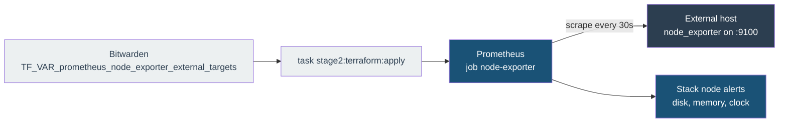

# Monitoring a host outside the cluster

Adds host metrics (CPU, memory, disk, filesystem, reboots, clock) for any Linux machine that is not a Kubernetes node, such as a NAS, a DNS server or a spare Raspberry Pi. Cluster nodes already run node_exporter through the monitoring module and need none of this.

The cluster cannot schedule anything onto a machine it does not manage, so node_exporter is installed on the host once by hand. Prometheus then scrapes it from inside the cluster.

## How it works



The scrape job is named `node-exporter`, the same as the in-cluster exporter, so the kube-prometheus-stack node alerting rules (filesystem filling up, clock skew, memory pressure and the rest) apply to the external host with no extra rules. The host is told apart by its `instance` label.

## 1. Install node_exporter on the host

Pick one method.

### Option A: distribution package (Debian, Ubuntu, Raspberry Pi OS)

```bash
sudo apt update
sudo apt install prometheus-node-exporter
```

The package creates and starts the `prometheus-node-exporter` systemd service on port 9100. Its version follows the distribution release, so it can be older than upstream.

### Option B: upstream binary (any Linux with systemd)

Check the [node_exporter releases](https://github.com/prometheus/node_exporter/releases) page for the current version and set it below.

```bash
VERSION=1.12.1
case "$(uname -m)" in
  x86_64) ARCH=amd64 ;;
  aarch64) ARCH=arm64 ;;
  armv7l) ARCH=armv7 ;;
  *) echo "unsupported: $(uname -m)"; exit 1 ;;
esac

cd /tmp
curl -fsSLO "https://github.com/prometheus/node_exporter/releases/download/v${VERSION}/node_exporter-${VERSION}.linux-${ARCH}.tar.gz"
curl -fsSLO "https://github.com/prometheus/node_exporter/releases/download/v${VERSION}/sha256sums.txt"
grep "node_exporter-${VERSION}.linux-${ARCH}.tar.gz" sha256sums.txt | sha256sum -c -

tar xzf "node_exporter-${VERSION}.linux-${ARCH}.tar.gz"
sudo install -m 0755 "node_exporter-${VERSION}.linux-${ARCH}/node_exporter" /usr/local/bin/node_exporter
sudo useradd --system --no-create-home --shell /usr/sbin/nologin node_exporter

sudo tee /etc/systemd/system/node_exporter.service >/dev/null <<'EOF'
[Unit]
Description=Prometheus node_exporter
After=network-online.target
Wants=network-online.target

[Service]
User=node_exporter
ExecStart=/usr/local/bin/node_exporter
Restart=on-failure

[Install]
WantedBy=multi-user.target
EOF

sudo systemctl daemon-reload
sudo systemctl enable --now node_exporter
```

To upgrade later, repeat the download, checksum and `install` lines with the new version, then `sudo systemctl restart node_exporter`.

### Check it locally

```bash
curl -s http://localhost:9100/metrics | grep '^node_uname_info'
```

One `node_uname_info` line means the exporter is running.

## 2. Open port 9100 to the cluster only

node_exporter has no authentication. Allow the cluster nodes and nothing else. With UFW, once per cluster node address:

```bash
sudo ufw allow from <cluster-node-ip> to any port 9100 proto tcp
```

Pod traffic leaves the cluster through the node's address, so the node IPs are the sources to allow.

Then confirm the cluster can reach it:

```bash
kubectl run ne-check --rm -i --restart=Never --image=curlimages/curl:8.17.0 -- \
  -s http://<host>:9100/metrics | grep '^node_uname_info'
```

## 3. Add the host to the scrape configuration

The target list is a Bitwarden secret, so no host address is committed to the repository. Set `TF_VAR_prometheus_node_exporter_external_targets` to a raw JSON list of `host:port` entries, keeping any hosts already in it:

```json
["<host>:9100"]
```

Then apply Stage 2. CI does not apply Terraform.

```bash
task stage2:terraform:apply
```

An empty list (the default) renders no job at all. A malformed entry fails `terraform plan`.

## 4. Verify in Prometheus

```promql
up{job="node-exporter", instance="<host>:9100"}
```

`1` means Prometheus is scraping the host. `0` means the scrape is failing; check `Status > Targets` in the Prometheus UI for the error, which is usually the firewall rule from step 2.

## Removing a host

Delete its entry from the secret and apply again. Then stop the exporter on the host (`sudo systemctl disable --now node_exporter`, or `prometheus-node-exporter` for the package) and remove the firewall rule.
